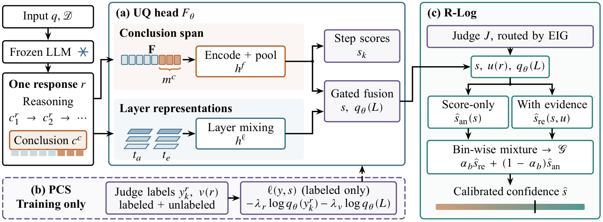

# ChainUQ

Uncertainty quantification for chain-of-thought answers of large language models, from the model's internal states
and an answer-blind judge.

ChainUQ trains a lightweight head on frozen backbone features to predict whether a generated answer is correct. With
privileged consistency supervision (PCS), the head also learns to imitate an answer-blind judge (its step labels and
chain verdict), which needs no reference answer and therefore also learns from unlabeled questions of new domains. A
reasoning-conditioned calibrator (R-Log) combines the head's outputs with chain evidence.

- **ChainUQ-A** uses no external model at inference.
- **ChainUQ** adds one answer-blind judge call per response; the information decomposition tells how much the judge
  and the internal states know beyond each other, and routes a budget of judge calls by expected information gain.

Both calibrate on correctness-labeled validation data of the target domain.



## Installation

Python 3.10 or newer and a CUDA build of PyTorch are required. From the repository root:

```bash
python -m venv .venv && source .venv/bin/activate
python -m pip install -r requirements.txt
cp .env.example .env
```

The package is imported in place: run every command from the repository root (`python -m chainuq.<module>`).

## Configuration

`.env` holds all paths and devices; shell exports take precedence, and relative paths resolve against the
repository root ([configuration reference](docs/configuration.md)).

```dotenv
CHAINUQ_ARTIFACTS=artifacts                              # generations, judge outputs, features, heads, results
CHAINUQ_POOL_ARTIFACTS=${CHAINUQ_ARTIFACTS}/pools        # 6,000-question unlabeled pools
CHAINUQ_ANALYSIS=${CHAINUQ_ARTIFACTS}/analysis           # Stage-2 analyses
CHAINUQ_DATASETS=datasets
CHAINUQ_MODELS=models
CHAINUQ_GEN_GPU=0
CHAINUQ_JUDGE_GPU=1
```

Place the models under `CHAINUQ_MODELS` with the directory names of [`registry.py`](chainuq/registry.py):
Llama-3.1-8B-Instruct, Qwen3-8B and Ministral-8B-Instruct-2410 (backbones), gpt-oss-20b (main judge),
gpt-oss-120b and Qwen3-4B-Instruct-2507 (further judges), Skywork-Reward-V2-Llama-3.1-8B and deberta-large-mnli
(baselines).

## Quick start

Prepare the datasets (network access or a populated Hugging Face cache), then run one backbone on HotpotQA:

```bash
python -m chainuq.pipeline.prepare_data --pools 2000,6000
python -m chainuq.pipeline.generate --backbone llama --dataset hotpotqa --splits train,validation,test
python -m chainuq.pipeline.features --backbone llama --dataset hotpotqa --splits train,validation,test

scripts/serve_model.sh gpt-oss-20b &       # judge server on CHAINUQ_JUDGE_GPU
for task in correct steps final_blind; do
  python -m chainuq.pipeline.judge --judge gptoss --task "$task" --backbone llama --dataset hotpotqa \
      --splits train,validation,test
done

python -m chainuq.pipeline.train --backbone llama --methods chainuq-source,saplma --seeds 2026
```

`chainuq-source` is the ChainUQ head with PCS on the labeled source only; the final head `chainuq` additionally
needs the unlabeled pools (`scripts/run_backbone.sh <backbone> pools`). `python -m chainuq.pipeline.evaluate
--backbone llama` then scores every method on the test split.

## Reproducing the paper

```bash
scripts/reproduce.sh
```

runs data preparation, the main run (`run_main.sh`), further judges (`run_judges.sh`), ablations
(`run_ablations.sh`), thinking mode (`run_thinking.sh`), the Stage-2 analyses (`run_analysis.sh`) and writes every
generated table and figure to `CHAINUQ_PAPER_DIR` (`run_paper.sh`). The stages, protocol and the producer of each
paper output are listed in [reproduction](docs/reproduction.md).

## Repository layout

```text
chainuq/
  config.py            dotenv loader and paths
  registry.py          backbones, judges, datasets, baselines, final method keys
  artifacts.py         artifact layout and JSONL I/O
  data/                dataset loaders, prompts, answer matching, response parsing
  heads/               ChainUQ head and supervised probe baselines
  samples.py           per-response records from generations, judge outputs and features
  training.py          head training (answer loss and PCS) and prediction
  evidence.py          reasoning-chain evidence u(r) and span features
  calibration.py       scalar calibrators, R-Log, BWH
  evaluation.py        evidence assembly and scoring of one evaluation cell
  metrics.py           discrimination and calibration metrics
  nli.py               NLI model of the sampling baselines
  pipeline/            prepare_data → generate → judge → features → cotuq/scores → train → evaluate, audit
  analysis/            evidence cache, Stage-2 variants, information decomposition, routing, fusion baselines,
                       response-level analyses, calibrators, significance, costs
  reports/             paper tables, in-text numbers and figures
scripts/               driver scripts (configured by .env)
docs/                  method, reproduction, artifacts, configuration
```

## Documentation

- [Method and implementation](docs/method.md)
- [Reproduction](docs/reproduction.md)
- [Artifacts and record formats](docs/artifacts.md)
- [Configuration](docs/configuration.md)

## License

ChainUQ is released under the [MIT License](LICENSE). Models and datasets keep their own licenses.
