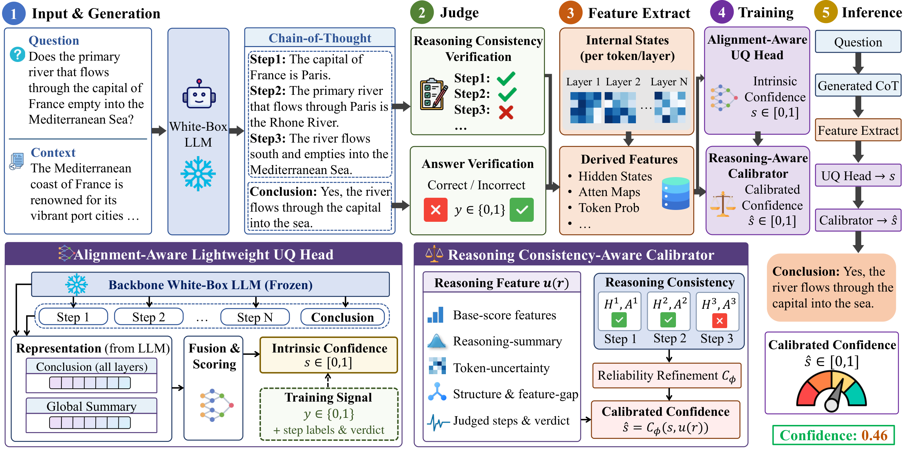

# ChainUQ

**Reasoning consistency-aware uncertainty quantification for large language models.**

ChainUQ estimates how likely a chain-of-thought response is to be correct. It combines two components:

1. a lightweight **UQ head** on frozen backbone features aligned to the response's conclusion, trained to
   internalize a judge's answer-blind reasoning-consistency judgments (*privileged consistency supervision*,
   used only during training);
2. a **reasoning consistency-aware calibrator** (R-Log) that refines the head score with evidence from the
   reasoning chain: step-level head scores, token uncertainty, chain structure, and, if available at
   inference, the judge's step labels and chain verdict.

**ChainUQ-A** is the judge-free variant: it queries no external model at inference. Because the consistency
targets never use the reference answer, the head can also be **adapted to a new domain from unlabeled
questions alone**.



## Results

Test AUROC (↑) and ECE (↓), averaged over HotpotQA (in-distribution) and five out-of-distribution
benchmarks (MuSiQue, StrategyQA, bAbI, GSM8K, MATH-500); heads are trained on HotpotQA only (10 seeds).

| Backbone | ChainUQ AUROC | ChainUQ-A AUROC | Judge-Final AUROC | Best judge-free baseline AUROC | ChainUQ ECE |
|---|---|---|---|---|---|
| Llama-3.1-8B-Instruct | **0.902** | 0.826 | 0.849 | 0.776 (SelfCheckGPT) | 0.021 |
| Qwen3-8B | **0.901** | 0.859 | 0.841 | 0.829 (AttnPool-MLP) | 0.023 |
| Ministral-8B-Instruct-2410 | **0.897** | 0.837 | 0.848 | 0.758 (SAPLMA) | 0.028 |

Across the 108 (backbone × dataset × metric) cells, ChainUQ matches or beats the strongest baseline in 68 and
ChainUQ-A beats the strongest judge-free baseline in 62. A fresh held-out split (Test-2), evaluated once with
the frozen pipeline, replicates these results. Every table and figure of the paper is regenerated by
`python -m chainuq.experiments.paper` (see [docs/reproduction.md](docs/reproduction.md)).

## Installation

Extract the anonymous source archive, then run:

```bash
cd ChainUQ
conda create -n chainuq python=3.11 -y && conda activate chainuq
pip install -e ".[serve,dev]"        # or: pip install -r requirements.txt (tested versions)
cp .env.example .env                 # then edit paths and GPUs
```

Generation, judging, and feature extraction need GPUs (two 80 GB GPUs were used: one for the backbone,
one for the judge server). Calibration and evaluation run on CPU.

## Configuration

All paths and devices come from environment variables, read from `.env` at the repository root
(variables already set in the shell take precedence):

Keep machine-specific paths and credentials in the local, Git-ignored `.env` file. The shared
`.env.example` contains portable defaults; include it when distributing the anonymous source.

| Variable | Meaning |
|---|---|
| `CHAINUQ_ARTIFACTS` | generations, judge labels, features, checkpoints, predictions, results |
| `CHAINUQ_DATASETS` | prepared benchmark splits |
| `CHAINUQ_MODELS` | one directory per model (names in [`chainuq/registry.py`](chainuq/registry.py)) |
| `CHAINUQ_PAPER_DIR` | LaTeX project that receives generated tables and figures |
| `CHAINUQ_GEN_GPU`, `CHAINUQ_JUDGE_GPU`, `CHAINUQ_JUDGE_PORT` | devices and judge-server port of the driver scripts |

## Models and data

| Role | Models (Hugging Face) |
|---|---|
| Backbones | `meta-llama/Llama-3.1-8B-Instruct`, `Qwen/Qwen3-8B`, `mistralai/Ministral-8B-Instruct-2410` |
| Main judge | `openai/gpt-oss-20b` |
| Alternative labelers | `Qwen/Qwen3-4B-Instruct-2507`, `Qwen/Qwen3-1.7B`, the backbones themselves, `microsoft/deberta-large-mnli` |
| Reward-model baseline | `Skywork/Skywork-Reward-V2-Llama-3.1-8B` |

Download each model into `$CHAINUQ_MODELS/<name>` (e.g. `huggingface-cli download openai/gpt-oss-20b --local-dir
models/gpt-oss-20b`). The benchmarks are downloaded from the Hugging Face Hub and split deterministically:

```bash
python -m chainuq.pipeline.prepare_data --pools 2000,6000
```

## Quick start (one backbone)

```bash
B=llama
python -m chainuq.pipeline.generate  --backbone $B --dataset hotpotqa --splits train,validation,test
python -m chainuq.pipeline.features  --backbone $B --dataset hotpotqa --splits train,validation,test
scripts/serve_model.sh gpt-oss-20b 8100 1 &                     # judge server
python -m chainuq.pipeline.judge --judge gptoss --task correct --backbone $B --dataset hotpotqa --splits train,validation,test
python -m chainuq.pipeline.judge --judge gptoss --task steps --backbone $B --dataset hotpotqa --splits train,validation,test
python -m chainuq.pipeline.judge --judge gptoss --task final_blind --backbone $B --dataset hotpotqa --splits train,validation,test
python -m chainuq.pipeline.train     --backbone $B --methods chainuq       # 10 seeds
python -m chainuq.pipeline.evaluate  --backbone $B                         # results/<backbone>/eval.json, tables.md
```

Repeat generation, features, and judging (`validation,test`) for the other datasets to evaluate
out of distribution; `python -m chainuq.pipeline.scores` and `--methods uhead,saplma,...` add the baselines.

## Reproducing the paper

```bash
scripts/reproduce.sh
```

runs every stage in order: `prepare_data` → `run_main.sh` (main comparison) → `run_verifiers.sh` (alternative
labelers) → `run_ablations.sh` (ablations, label efficiency, significance) → `run_adaptation.sh` (label-free
adaptation) → `run_paper.sh` (costs, efficiency, tables and figures). [docs/reproduction.md](docs/reproduction.md)
maps every table and figure to the commands and result files that produce it.

## Repository structure

```text
chainuq/
├── config.py, registry.py      paths (.env), seeds; models, datasets, method names
├── artifacts.py                artifact layout and JSONL I/O
├── data/                       benchmark loaders, prompts, answer matching, response parsing
├── samples.py                  per-response records from generations, judge labels, and features
├── heads/                      ChainUQ head (encoder + layer branch + PCS outputs) and probe baselines
├── training.py                 training recipe, PCS loss, prediction
├── evidence.py                 reasoning-chain evidence u(r)
├── calibration.py              PS / TS / ISO, BWH, R-Log
├── evaluation.py, metrics.py   evidence assembly, scoring, aggregation over seeds
├── adaptation.py               label-free target adaptation
├── pipeline/                   stages: prepare_data, generate, judge, features, cotuq, nli_steps, scores, train, evaluate, audit
└── experiments/                paper analyses: analysis, significance, adapt, adapt_eval, costs, benchmark, paper
scripts/                        GPU drivers for the full reproduction (bash)
tests/                          unit tests (pytest)
docs/                           method, reproduction, and artifact documentation
```

## Documentation

- [docs/method.md](docs/method.md): the method and where each part is implemented
- [docs/reproduction.md](docs/reproduction.md): pipeline stages, compute, and the paper table/figure map
- [docs/artifacts.md](docs/artifacts.md): artifact layout, file formats, and method keys

## Tests

```bash
pytest
```

## License

[MIT](LICENSE)
